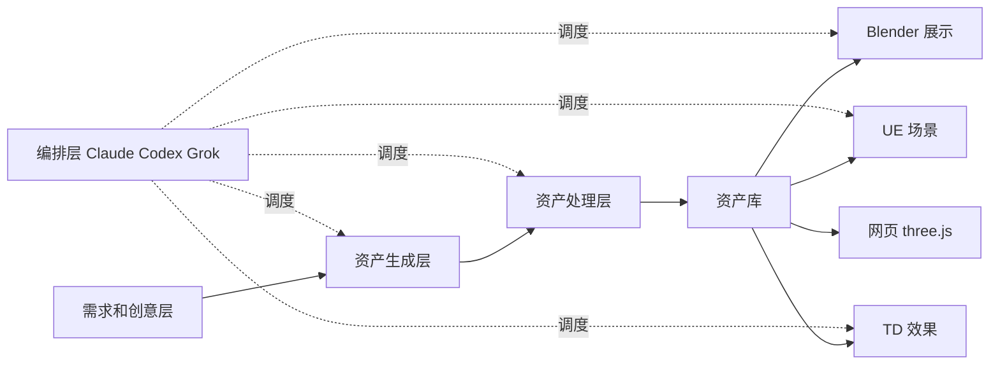

# AI + Tripo 3D 产线架构说明(供 AI 阅读)

> 作者:Theodore。整理日期:2026-10-15。
> 目标:以 Tripo 为核心资产来源,结合其他 AI、开源项目和工具,在具体场景(Blender 3D 展示、UE 游戏场景、TouchDesigner 效果演示、网页 three.js)中稳定产出,并包装成一个可以无限扩展、修改的生态或产线。
> 前提:Tripo 单独产出的质量还不足以直接交付,必须配合后处理和其他工具一起使用。

## 1. 设计原则
1. **分层加插件**:每个环节都是可替换的模块,模块之间只通过标准文件格式(glb/fbx 加 JSON 元数据)和 MCP 接口对接。MCP 是让 AI 直接操作软件的协议。
2. **订单驱动**:每个任务从一份统一的 JSON 订单开始,下游所有环节都按订单执行。
3. **新增场景等于新增模块**:每个场景是一个独立的 skill 文件夹加一个 MCP,不改动其他层。
4. **版本化**:所有 skill、模板、订单格式放在同一个 Git 仓库里管理。
5. **全程留档**:每次运行都保存订单、过程日志和成品,用于复盘、做案例展示和包装产品。
6. **先打通一条线**:先跑通 Tripo、Blender 清理、Blender 展示出片这一条,稳定后再接 UE 和 TD。

## 2. 架构总览


## 3. 各层说明

### 3.1 需求和创意层
- 用 LLM 把一句需求拆成资产清单,写成订单 JSON(格式见第 5 节)。
- 输出物体、风格、参考图、面数上限、目标场景、交付格式。

### 3.2 资产生成层(多来源路由)
- **Tripo**:主体模型。官方 MCP 是 [VAST-AI-Research/tripo-mcp](https://github.com/VAST-AI-Research/tripo-mcp);需要节点批处理时用 [ComfyUI-Tripo](https://github.com/VAST-AI-Research/ComfyUI-Tripo)。
- **概念图**:先用图像模型出图,再图生 3D,质量比纯文字生成稳定。
- **贴图**:必要时用 AI 重新生成或修补。
- **简单几何体**:直接让 AI 写 Blender Python 脚本生成。
- 每个来源都封装成插件,由编排层按质量和成本选用。

### 3.3 资产处理层(补 Tripo 质量短板,最关键)
- 在 Blender 里自动做:减面、重拓扑、UV、材质修复、绑骨、动作。
- 设置质检步骤(面数、破面、贴图缺失、比例等),不合格就打回生成层重做。
- 工具:
  - [ahujasid/mcp-for-blender](https://github.com/ahujasid/mcp-for-blender):最主流的 Blender MCP。
  - [HoldMyBeer-gg/blenderwright](https://github.com/HoldMyBeer-gg/blenderwright):191 个工具,建模、材质、渲染。
  - [arjun988/blender-skills](https://github.com/arjun988/blender-skills):94 个 Blender 专项 skill,支持 Claude Code、Codex、Cursor。
  - [squall01337/mixamo-llm-mocap](https://github.com/squall01337/mixamo-llm-mocap):视频转动作并套到 Mixamo 骨骼。
  - Charakuru(きゃらくる)免费套件:Tripo P2.0 配合 Codex 自动完成角色绑骨和表情,见 [发布帖](https://x.com/Dstudio_ai/status/2107396576931197427)。
- 社区经验:最大的瓶颈是 Tripo 到 Blender 的拓扑和材质清理,这一步仍需人工抽检。修手脚、头发缝隙这类细节时,让 AI 看屏幕直接操作 Blender,效果比通过 MCP 好,但更费 token。

### 3.4 资产库(中间货币)
- 统一导出 glb 和 fbx。
- 每个资产配一份 `meta.json`,记录来源、订单 id、版本、面数、标签、授权。
- 所有下游场景只从资产库取货。

### 3.5 场景应用层
| 场景 | 接入方式 | 参考 |
|---|---|---|
| Blender 3D 展示 | Blender MCP,把灯光、相机、转台渲染做成脚本模板 | mcp-for-blender |
| UE 游戏场景 | Epic 官方 Unreal MCP(UE 5.8 以上) | [unreal-agent-harness](https://github.com/per-simmons/unreal-agent-harness) |
| TouchDesigner 效果 | TD MCP | 官方 [TouchDesigner/TDMCP](https://github.com/TouchDesigner/TDMCP),社区 [8beeeaaat/touchdesigner-mcp](https://github.com/8beeeaaat/touchdesigner-mcp),功能最全的是 [Embody](https://github.com/dylanroscover/Embody) |
| 网页 three.js | 直接加载 glb | [3d-vibe-coding-handbook](https://github.com/alchaincyf/3d-vibe-coding-handbook) |

### 3.6 编排层(多 AI 协作)
- 分工建议:Claude 负责规划、审核和质检判断;Codex 写脚本、调 MCP;Grok 搜参考、趋势和案例。
- 可用框架:
  - [777genius/agent-teams-ai](https://github.com/777genius/agent-teams-ai):agent 之间互相发消息、互审。
  - [slopus/happy](https://github.com/slopus/happy):在一个应用里调度 Claude、Codex、Grok。
  - [spacering-net/codeg](https://github.com/spacering-net/codeg):多 agent 协作编程工作区。

## 4. 建议的仓库目录结构
```
pipeline/
├─ README.md            # 本文档
├─ schemas/order.schema.json
├─ orders/              # 每个任务一份订单
├─ layers/
│  ├─ generate/         # tripo/, image2d/, procedural/ 各为插件
│  ├─ process/          # cleanup/, retopo/, rig/, qa/
│  └─ apps/             # blender-showcase/, ue-scene/, td-fx/, web-threejs/
├─ library/             # 资产库:<asset_id>/model.glb + meta.json
├─ skills/              # 每个 skill 一个文件夹,带 SKILL.md
├─ mcp/                 # 各 MCP 的配置
└─ runs/                # 每次运行的日志和成品
```

## 5. 订单 JSON 示例
```json
{
  "order_id": "2026-10-15-001",
  "brief": "赛博风格 F1 赛车,用于网页展示",
  "assets": [
    {"name": "f1_car", "source": "tripo", "style": "cyberpunk", "ref_images": ["refs/car.png"], "max_faces": 50000, "rig": false}
  ],
  "targets": ["blender-showcase", "web-threejs"],
  "deliver": {"formats": ["glb", "mp4"], "resolution": "1920x1080"}
}
```

## 6. 新增一个模块的步骤
1. 在 `layers/<层>/` 下新建文件夹。
2. 写 `SKILL.md`:输入、输出、依赖的 MCP、操作步骤、质检标准。
3. 在 `mcp/` 里加配置。
4. 输入输出都遵守资产库和订单格式。
5. 用一份测试订单跑通,并把结果记录到 `runs/`。

## 7. 路线图
1. 第一阶段:Tripo、Blender 清理、Blender 展示出片。
2. 第二阶段:接入网页 three.js 和 UE 场景。
3. 第三阶段:接入 TD 效果和多 AI 编排自动化。
4. 第四阶段:沉淀案例,包装成对外的生态或产品。

## 8. 参考案例
- [Sac 的《小王子》3D 游戏](https://x.com/Saccc_c/status/2109962425512734739):Opus 5.5、Tripo、Blender,一人 16 天完成,作者表示之后会开源流程。
- [uep 的对比实验](https://x.com/uep1up/status/2110325117448536075):使用 Charakuru 后,制作时间从约 11.5 小时降到约 6.2 小时。
- [Tripo 到 Roblox](https://x.com/SushiNFTart/status/2110310840385814620):AI 同时操作 Blender 和 Roblox Studio。
- [怪化猫 three.js 世界](https://x.com/megurosumi/status/2110273623181406298):Claude Code、Tripo、Blender,浏览器可玩。
